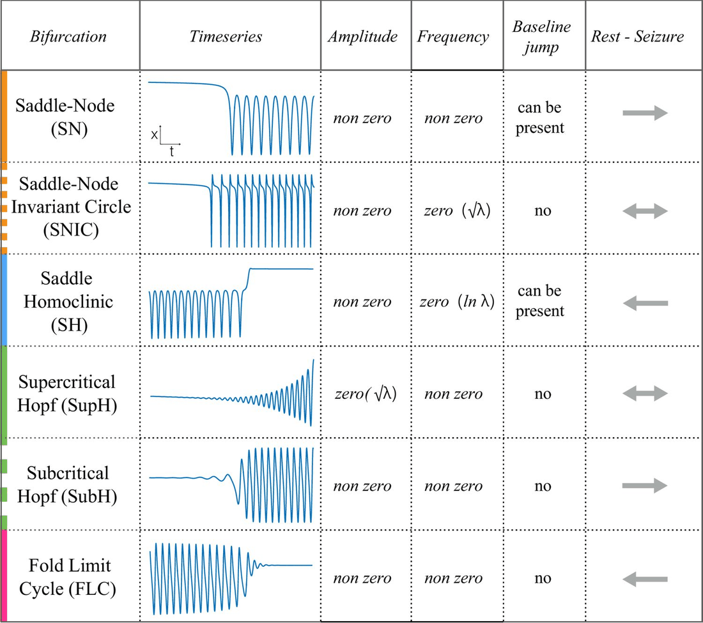
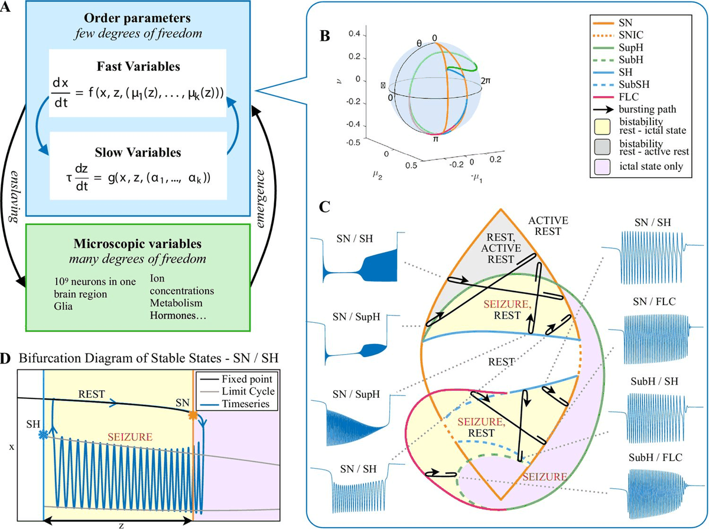
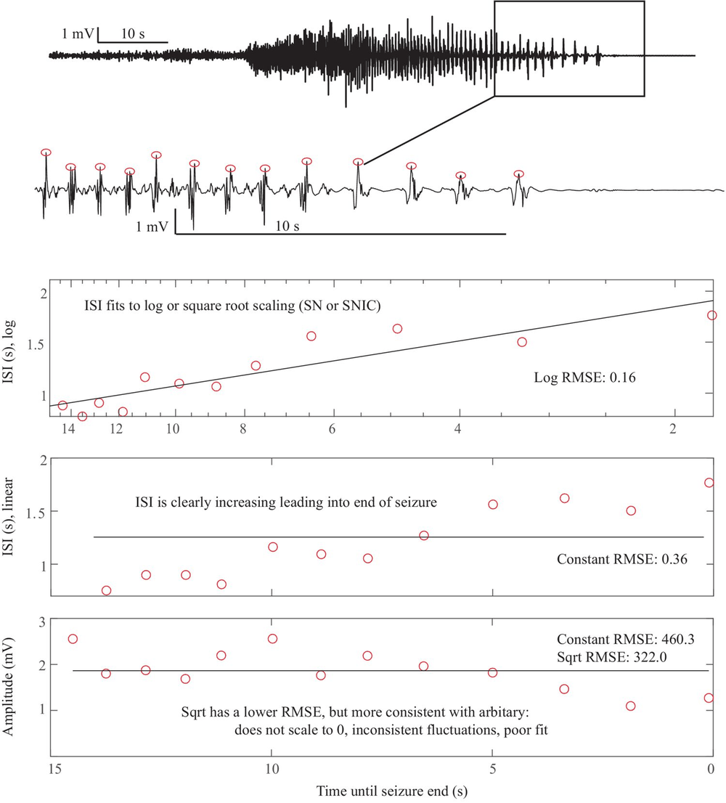
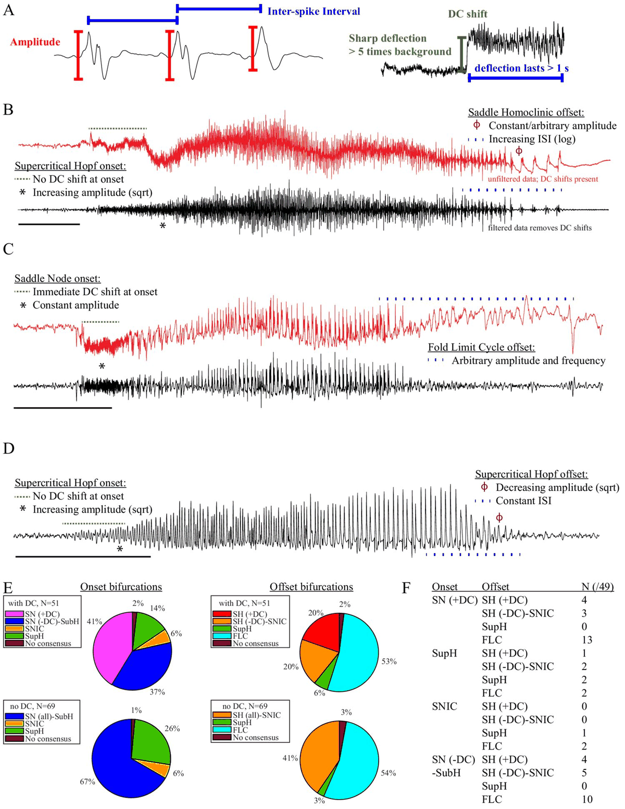

# Seizures as tipping points — nonlinear dynamics of epilepsy

> [!summary] One line
> A neuron is a nonlinear dynamical system. A seizure starts and stops when a slowly changing quantity pushes that system through a **bifurcation**. The type of bifurcation leaves a measurable fingerprint, which you can predict on paper, find in simulation, and look for in recordings.

A four-week computational physics project (MnP, IIT Bombay).

## Why this is a physics project

The subject matter is the brain, but every tool used here is standard physics:

| What we do | Where it comes from in physics |
|---|---|
| Treat the membrane as an RC circuit with nonlinear conductances | circuit theory: Kirchhoff's laws, the same as for any device |
| Derive reversal potentials from the Nernst equation | equilibrium statistical mechanics: Boltzmann distribution of ions |
| Classify how rest turns into oscillation (Hopf, saddle-node, homoclinic) | **nonlinear dynamics / bifurcation theory**, the same mathematics as the onset of lasing (a supercritical Hopf bifurcation of the optical field), the onset of convection, or the voltage of a current-biased Josephson junction, which switches on through exactly the SNIC bifurcation of week 1 ($\langle V\rangle\propto\sqrt{I^2-I_c^2}$) |
| Separate fast and slow variables | adiabatic elimination / singular perturbation theory, as in Born–Oppenheimer or slaved modes in lasers |
| Use scaling laws near a critical point to identify a transition | the logic of critical exponents in phase transitions |
| Synchronization of many oscillators (extension) | the Kuramoto model, used for Josephson arrays, lasers and power grids |

The project is really "nonlinear dynamics, with a system where the answer matters". Students who later work on lasers, superconducting circuits, plasmas or climate will use the same toolbox.

## Symbols used throughout

| Symbol | Meaning |
|---|---|
| $V$ | membrane voltage (mV) |
| $C$ | membrane capacitance per area (µF/cm²) |
| $g_X$, $E_X$ | conductance and reversal (Nernst) potential of ion species or channel $X$ |
| $[K^+]_o$, $[K^+]_i$ | potassium concentration outside and inside the cell (mM) |
| $I$ | applied current |
| $\mu$ | distance of a control parameter from a bifurcation point |
| $\lambda$ | eigenvalue of a Jacobian (local growth rate) |
| $f$ | firing rate (Hz) |
| ISI | inter-spike interval |
| fast / slow variables | quantities that change in milliseconds (voltage, channel gates) vs seconds (ion concentrations, the Epileptor's $z$) |

## The idea in four steps

**1. Excitability.** Positive feedback (sodium channels) plus slower negative feedback (potassium channels) produces a *threshold*: small inputs decay and large inputs produce a full spike. In a two-variable model, the threshold is a curve in the phase plane.

**2. Two ways to start firing.** When a control parameter (current, or extracellular potassium) changes, the resting state is lost in one of two generic ways:
- **Hopf:** oscillation starts at finite frequency.
- **Saddle-node on an invariant circle (SNIC):** oscillation starts at zero frequency, with the rate growing as $f\propto\mu^{1/2}$.

**3. Slow variables make seizures.** Spikes release K⁺, and pumps and glial cells remove it over seconds. Freeze the slow variables and the fast neuron has a bifurcation diagram. Let them move, and they drag the neuron back and forth across its bifurcations. That gives periodic, self-terminating events: seizure-like bursts.

**4. The fingerprint at onset and offset.** Each bifurcation predicts how amplitude and frequency behave as the transition is approached [1, 2]. For example, a homoclinic offset predicts spikes that slow down logarithmically, $\text{ISI}\propto-\ln\mu$, while their amplitude stays constant.


*Figure 1. The six bifurcations that can start (→) or stop (←) a seizure, each with an example time series and the scaling of amplitude and frequency with the distance to the bifurcation. SNIC and saddle-homoclinic transitions have zero frequency at the bifurcation; a supercritical Hopf has zero amplitude; the others have neither. From [2].*


*Figure 2. The fast–slow picture. A slow variable moves the fast subsystem across its bifurcation curves; each closed path is one onset/offset pair. Panel D is the class used in week 4: saddle-node onset, saddle-homoclinic offset. From [2].*


*Figure 3. Testing the offset prediction on a human intracranial recording: ISI against time until the end of the seizure, and spike amplitude. The ISI grows while the amplitude stays finite. From [2].*


*Figure 4. Classifying real seizures by their onset and offset bifurcations ("dynamotypes"), across patients. From [2].*

## Why it matters now

- **Brain–computer interfaces and neurotechnology.** Implanted closed-loop stimulators detect seizure onset and stimulate to abort it, so onset dynamics is the core signal. Neural-interface companies all model neural population dynamics.
- **"Computation through dynamics".** Dynamical systems are now the common language of systems neuroscience and BCI decoding [3].
- **Digital brain twins.** Patient-specific networks of Epileptor models, coupled through the patient's own connectome, are being tested for planning epilepsy surgery [4].

## Four-week plan

Each week has its own folder with a handout (`README.md`): the theory, the symbols, and the questions.

| Week | Topic | What you will build | What to look for |
|---|---|---|---|
| [1](week1/README.md) | Excitability | FitzHugh–Nagumo and Morris–Lecar phase planes; the Hopf point; firing-rate curves | Does firing start at zero frequency or jump to a finite rate? |
| [2](week2/README.md) | Potassium as a bifurcation parameter | A Hodgkin–Huxley-type neuron with fixed ion concentrations; fixed points and sweeps vs $[K^+]_o$ | Which bifurcation starts the firing, and what silences it again? |
| [3](week3/README.md) | Neuron–glia interaction | Slow K⁺/Na⁺ dynamics, pumps and glia added to the week 2 neuron | Where, relative to week 2's bifurcation, does each seizure start and stop? |
| [4](week4/README.md) | The Epileptor | The slow manifold by hand; simulation; inter-spike intervals before offset; an excitability sweep | Can you predict when seizures appear, and tell how they end? |

## How the project works

1. Each week, read the handout and attempt the *Predict* parts on paper first.
2. Write your own code. You may use AI assistants for the code, but the predictions and explanations must be your own.
3. Produce the plots and answer the *Explain* parts in a short write-up.
4. Expect a short viva on your own plots: you should be able to say what every feature in them means.

## Setup

Python 3 with `numpy`, `scipy` and `matplotlib` is all you need:

```bash
pip install numpy scipy matplotlib
```

Most models here are *stiff*: use `scipy.integrate.solve_ivp` with `method="LSODA"` or `"BDF"`.

## References

[1] V. K. Jirsa, W. C. Stacey, P. P. Quilichini, A. I. Ivanov and C. Bernard, "On the nature of seizure dynamics", *Brain* **137**, 2210 (2014), doi:10.1093/brain/awu133.
[2] M. L. Saggio *et al.*, "A taxonomy of seizure dynamotypes", *eLife* **9**, e55632 (2020), doi:10.7554/eLife.55632. Figures 1–4 above are reproduced from this article under CC BY 4.0.
[3] S. Vyas, M. D. Golub, D. Sussillo and K. V. Shenoy, "Computation through neural population dynamics", *Annu. Rev. Neurosci.* **43**, 249 (2020).
[4] V. K. Jirsa *et al.*, "The Virtual Epileptic Patient: individualized whole-brain models of epilepsy spread", *NeuroImage* **145**, 377 (2017).
[5] J. R. Cressman Jr., G. Ullah, J. Ziburkus, S. J. Schiff and E. Barreto, "The influence of sodium and potassium dynamics on excitability, seizures, and the stability of persistent states: I. Single neuron dynamics", *J. Comput. Neurosci.* **26**, 159 (2009); erratum (2011).
[6] A. L. Hodgkin and A. F. Huxley, "A quantitative description of membrane current and its application to conduction and excitation in nerve", *J. Physiol.* **117**, 500 (1952).
[7] S. H. Strogatz, *Nonlinear Dynamics and Chaos*, 2nd ed., CRC Press (2015). Lecture videos: [Cornell 2014 course on YouTube](https://www.youtube.com/playlist?list=PLbN57C5Zdl6j_qJA-pARJnKsmROzPnO9V).
[8] E. M. Izhikevich, *Dynamical Systems in Neuroscience: The Geometry of Excitability and Bursting*, MIT Press (2007).
[9] W. Gerstner, W. M. Kistler, R. Naud and L. Paninski, *Neuronal Dynamics*, Cambridge University Press (2014). Free online: [neuronaldynamics.epfl.ch](https://neuronaldynamics.epfl.ch).
[10] B. Ermentrout and D. Terman, *Mathematical Foundations of Neuroscience*, Springer (2010).
[11] J. Rinzel and G. B. Ermentrout, "Analysis of neural excitability and oscillations", in C. Koch and I. Segev (eds.), *Methods in Neuronal Modeling*, 2nd ed., MIT Press (1998).
[12] Neuromatch Academy, *Computational Neuroscience* course, [compneuro.neuromatch.io](https://compneuro.neuromatch.io).
[13] The Virtual Brain, *Modeling Epilepsy* tutorial, [docs.thevirtualbrain.org](https://docs.thevirtualbrain.org/tutorials/tutorial_3_ModelingEpilepsy.html).
[14] CHB-MIT Scalp EEG Database, PhysioNet, [physionet.org/content/chbmit/1.0.0](https://physionet.org/content/chbmit/1.0.0/).
